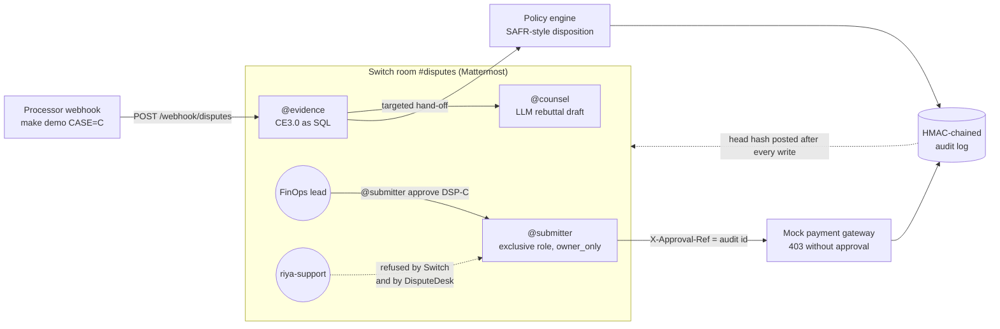

# DisputeDesk

**A Switch room where AI agents build Visa chargeback defenses and a human signs off on money decisions.**

Card-not-present fraud chargebacks (Visa reason code 10.4) are winnable. Since Compelling Evidence 3.0, a merchant can reverse one by showing two earlier, undisputed purchases on the same card that share the buyer's IP address or device. But the rule is fiddly, so most merchants just eat the loss. In DisputeDesk, an evidence agent runs the CE3.0 check as plain SQL and a counsel agent drafts the rebuttal; the LLM writes prose, never decisions. A policy engine routes each case to auto-file, human review, reject or file-but-flag. The only agent that can touch the payment gateway holds an exclusive Switch role and takes instructions from the FinOps lead alone. Every step lands in a tamper-evident, HMAC-chained audit log whose head is posted in the room.

## Architecture



## Why Switch?

| Switch feature | How DisputeDesk uses it | What breaks without it |
|---|---|---|
| **Exclusive role** `submitter` | Exactly one agent at a time can hold the money-moving job. The lease is tied to its live connection and re-taken on every reconnect. `@submitter` addresses the role, not a particular agent. | Two agents could both file the same representment, and replacing the agent would mean editing every instruction in the channel. |
| **Per-agent "who may instruct"** (`addressing: owner_only`) | Only the FinOps lead can address `disputedesk-gateway`. riya-support's "approve DSP-C" is refused by Switch, publicly in the room, before DisputeDesk even looks at it. | Any support person, or any other agent, could talk the submitter into a $2,400 filing. |
| **Room instructions** | Every agent that joins gets the same briefing: roles, dispositions, how approvals work. | Each agent improvises scope and tone. |
| **Room-scoped document** "CE3.0 rulebook" | The exact rule text lives in the room, so people and agents argue from the same source. | People and agents work from their own memory of a fiddly rule. |
| **Aliases** `@evidence`, `@counsel` | Short, stable handles scoped to this room. | Registered names like `disputedesk-evidence` leak into the conversation. |
| **The shared room log** | Each audit write posts the chain head (`audit #17 · 6d4a4fc976a4`). The room log is an outside record the database can't silently rewrite. | Decisions hide in agent logs, and silently deleting the newest audit rows goes unnoticed. |
| **Targeted messages** (`send_targeted_message`) | @evidence hands each case to @counsel explicitly. | Hand-offs depend on agents polling or guessing. |

## Agents connected

| Agent (registered name) | Room handle | What it does | LLM? |
|---|---|---|---|
| `disputedesk-evidence` | `@evidence` | Receives the processor webhook. Runs CE3.0 as parameterised SQL plus Python (`disputedesk/ce3.py`) and the policy engine (`policy.py`), writes the audit records, and posts the evidence table and disposition. | No |
| `disputedesk-counsel` | `@counsel` | Drafts the rebuttal text with Claude (`claude-sonnet-5-5`) and posts a recommendation derived from the policy outcome. Without an API key it uses a fixed template. | Rebuttal prose only |
| `disputedesk-gateway` | `@submitter` (exclusive role) | The only agent that calls the gateway. Files a case only when the audit log holds an approval for it: a policy auto-approval, or the FinOps lead's sign-off. Approvals are checked against the sender's stable Switch id, a mention of @submitter, and the case ID. | Tie-break only, for approve vs reject intent |

All three are custom clients built on the documented agent protocol: `POST /agents` registration, the SSE event stream, HTTP operations (`disputedesk/switch_client.py`).

## How the channel is set up

Tested with Switch 0.31.0, running the official compose stack on a Rosetta colima VM (Apple Silicon). `make h1` runs these steps (sources: `docs/h1-checklist.md`):
1. **Server.** The official Switch 0.31.0 compose stack (`ghcr.io/sandbox-quantum/standalone-compose`), with the profiles `collab` (bundled Mattermost) and `gateway`.
   - Its seeder links the FinOps lead's Gateway account to Mattermost user `finops-lead`.
2. **Registration key.** The FinOps lead creates one in the Gateway (**API Keys**). This is the only GUI step, and it makes them the owner of every agent.
3. **Agents.** The three agents register through `POST /agents`. Their keys go to `.env` (gitignored).
4. **Who may instruct the gateway.** `disputedesk-gateway` gets `addressing: owner_only`. A sibling agent sets it, because the operation is owner-only and "never yourself". Verified policy: `{owner: true, owner_agents: false, users: []}`.
5. **The room.** One `create_room` call builds `#disputes` with:
   - the room instructions (`switch/room-instructions.md`);
   - the aliases `@evidence` and `@counsel`;
   - the exclusive role `submitter`;
   - the three agents, plus `finops-lead` and `riya-support`.
6. **Room document.** @evidence creates the "CE3.0 rulebook" room document when it connects.
7. **The role.** @submitter takes the role with `assume_role` each time it connects.
8. **riya-support.** Created through the Mattermost API, as an unlinked support user.

## The rules

### Visa CE3.0 (reason code 10.4)

A dispute qualifies only if **at least two** prior transactions with the same merchant and the same payment credential:
- are each **120–365 days** before the dispute date (inclusive);
- are **undisputed** and have **no fraud report**;
- match the disputed transaction on **≥ 2** of {account/login ID, IP address, device ID, shipping address}, with **at least one of them being IP or device**.

The check is decided in SQL and Python only, and 75 boundary and adversarial tests cover it. The tests include 119/120/365/366 days, priors that were themselves disputed, a shipping-plus-account match with no IP or device, the wrong card, and a non-10.4 dispute.

### Four dispositions (SAFR-style; an industry reference framework, not regulation)

| Outcome | When | What happens |
|---|---|---|
| `AUTO_EXECUTE` | qualified and amount ≤ $500 (`config.yaml`) | auto-approved and filed |
| `HUMAN_REVIEW` | qualified and amount > $500 | waits for the FinOps lead |
| `REJECT` | not qualified | recommends accepting the loss, with the reason |
| `PROCEED_FLAGGED` | qualified and ≤ $500, but the customer has ≥ 2 other disputes in 60 days | filed, with a visible ⚠ flag |

### Tamper-evident audit chain

Each record stores `hash = HMAC-SHA256(key, prev_hash + canonical_json(record))`.
- **The gateway re-checks everything.** It verifies the chain on every call, and requires `X-Approval-Ref` to point at an approval record that:
  - is for that exact dispute;
  - carries an authorising event;
  - is within the auto limit, for auto approvals;
  - was signed by the FinOps lead, for human approvals;
  - hasn't been used before or revoked.
- **One money move per dispute.** Calls without a valid reference get a 403.
- **Tampering is caught.** `make tamper-demo` rewrites DSP-C's disposition in a copy of the database, and verification fails at that record.

## Quickstart

Requires Python ≥ 3.10 and `make`. Logic and tests need nothing else:

```bash
cp .env.example .env
make setup        # venv, pinned deps, generates AUDIT_HMAC_KEY, seeds demo cases A–E
make test         # 349 tests, no network or API key
```

For the live Switch room you also need Docker. On Apple Silicon, the Mattermost image is amd64-only, so give Docker Rosetta, e.g. `colima start switch --vm-type vz --vz-rosetta`. You also need `oras`.

```bash
make server-init && make server-up   # official Switch 0.31.0 stack + Mattermost + Gateway
# Gateway http://localhost:3000 (login in server/.env) > API Keys > Create Registration Key -> .env SWITCH_REGISTRATION_KEY
make h1           # registers agents, owner_only, room, aliases, role, riya-support
make gateway      # mock payment gateway on :8099 (terminal 1)
make agents       # @evidence, @counsel, @submitter (terminal 2)
make demo CASE=C  # simulate the processor webhook; approve with "@submitter approve DSP-C" in #disputes
make tamper-demo  # audit chain intact; tampered copy detected
```

Optional: add `ANTHROPIC_API_KEY` to `.env` so @counsel drafts with Claude.

## Honest limitations

- **The payment gateway is a mock** (`gateway/app.py`). Nothing is connected to Visa or a real processor. The cases are seeded data.
- **SAFR is a reference model,** used here as a disposition design pattern. It isn't a regulation and DisputeDesk doesn't claim compliance with it.
- **SSE transport.** The agents use Switch's SSE event stream as specified. Switch now recommends WebSocket and marks SSE deprecated.
- **No threads.** Posts go to the room root. The live `post_message` operation supports `thread_id` and the client implements it, but the demo doesn't use threads.
- **The HMAC key is the trust boundary.** Whoever holds `AUDIT_HMAC_KEY` can forge approvals; agents and the LLM never see it. Deleting the newest audit rows is caught by comparing against the head hash posted in the room, not by the chain alone.
- **Without `ANTHROPIC_API_KEY`,** @counsel uses a deterministic template. The demo transcript (`docs/demo-transcript.md`) was recorded live with Claude drafting.
- **No YAML room template.** The room is created with the `create_room` operation instead.

## How it was built

DisputeDesk was built as a **task graph** following the [graph-engineering](https://github.com/codejunkie99/graph-engineering) method (`references/task-graphs.md`):
1. A shared contract (`disputedesk/contracts.py`).
2. Four parallel workers, each owning its own files.
3. Three verifiers in separate contexts: CE3 correctness, gate integrity, reproducibility.
4. One owner of the merge.
5. Human gates only where a mistake is expensive.

The verifiers caught real defects: an unkeyed (forgeable) audit hash, auto-approvals at any amount, and a missing reason-code check. Each was fixed within the three-round cap. The build log is in `STATE.md`.
