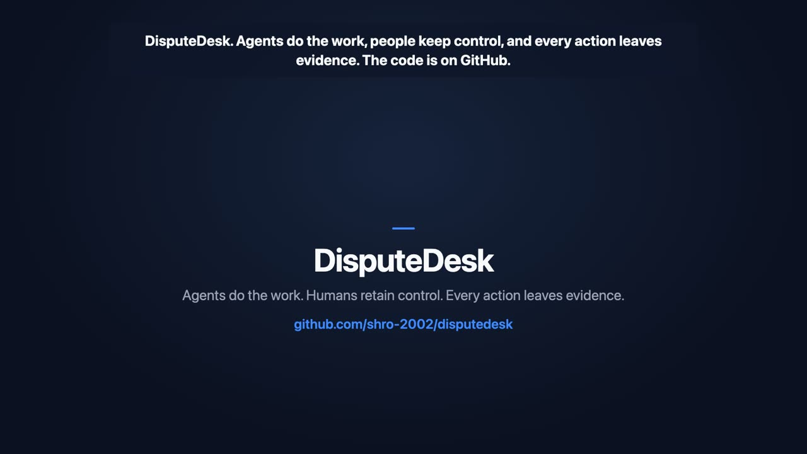
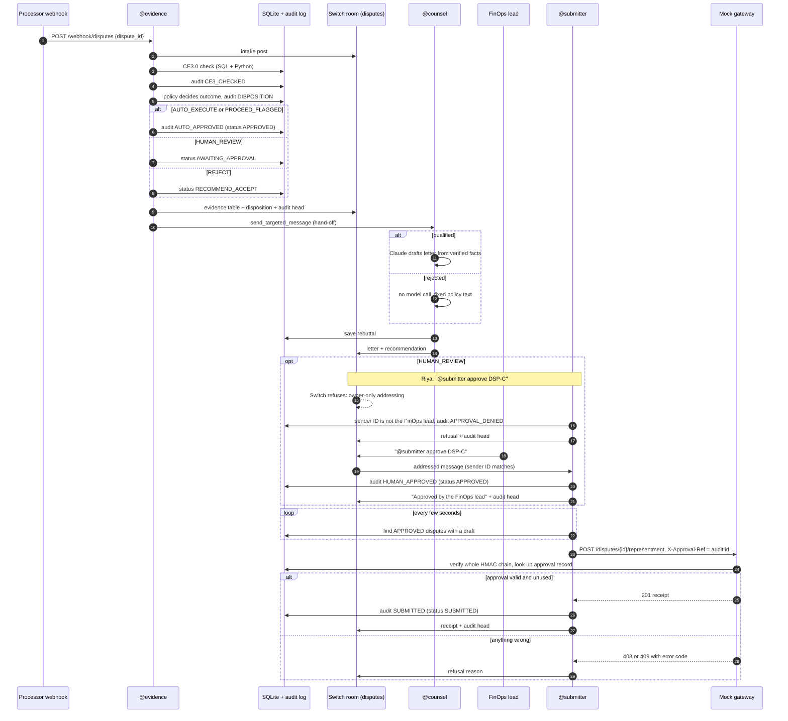
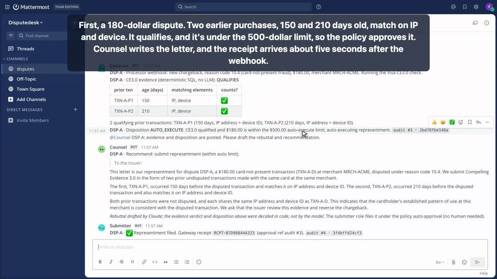
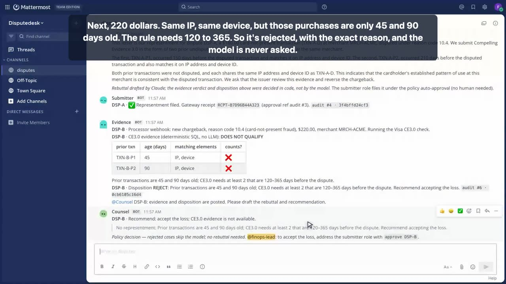
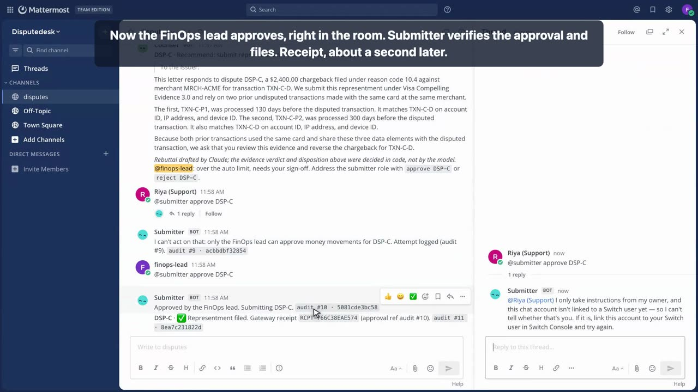
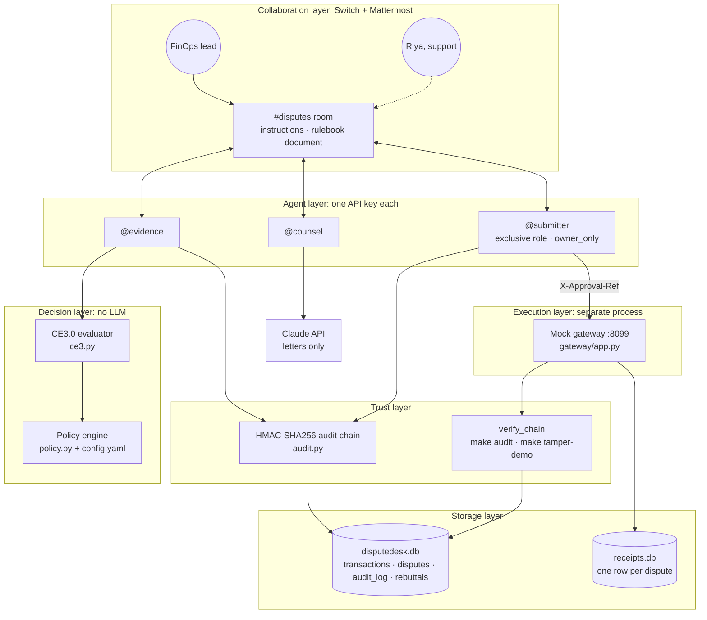
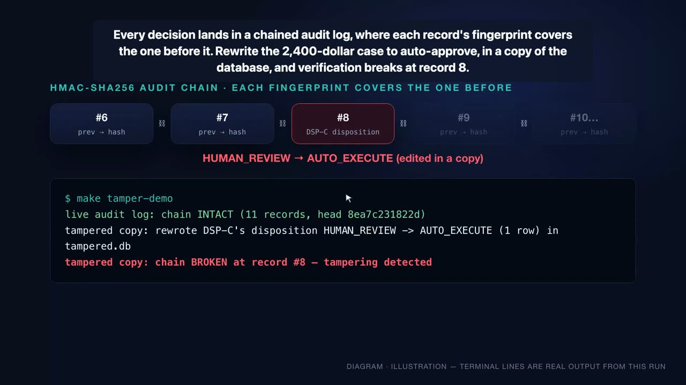

# DisputeDesk

**AI agents investigate chargebacks. Humans control the high-stakes decisions. Every action leaves a tamper-evident record.**

DisputeDesk is a [Switch](https://docs.switchagents.ai/) room where three AI agents and a merchant's finance team defend card-not-present fraud chargebacks (Visa reason code 10.4) together. When a dispute arrives, the agents:
- check the evidence against Visa's Compelling Evidence 3.0 (CE3.0) rule in code;
- draft the rebuttal letter;
- route the case by risk;
- file it through a payment gateway.

Small, provable cases file on their own. Large ones wait for the FinOps lead's approval in the room. Weak ones come back with a recommendation to accept the loss.

It is not a chatbot that answers questions about chargebacks. It runs the whole job, from webhook to receipt, and the model never decides anything that involves money. Switch provides the shared room, the agent handles, and the permissions: one exclusive role can move money, and it takes instructions only from its owner.


-2EA44F)


> **▶ Demo video (2 min 43 s): <https://youtu.be/A_EF8L1ivME>**
>
> The payment gateway is a **mock**, and all dispute data is synthetic. Nothing connects to Visa or a real processor.

---

## Judge's guide

| What to evaluate | Where to look |
|---|---|
| Product value | [The problem](#the-problem) · [Watch the demo](#watch-the-demo) |
| Human–agent collaboration | [End-to-end workflow](#end-to-end-workflow) |
| Switch integration | [Why Switch is essential](#why-switch-is-essential) |
| Technical architecture | [System architecture](#system-architecture) |
| Safety and permissions | [Security, authorization and trust](#security-authorization-and-trust) |
| Working proof | [Three demonstration scenarios](#three-demonstration-scenarios) |
| Reproducibility | [Quick start](#quick-start) · [Testing](#testing-and-technical-validation) |

## Contents

1. [Watch the demo](#watch-the-demo)
2. [The problem](#the-problem)
3. [The solution](#the-solution)
4. [What makes DisputeDesk different](#what-makes-disputedesk-different)
5. [End-to-end workflow](#end-to-end-workflow)
6. [Meet the agents](#meet-the-agents)
7. [Four policy outcomes](#four-policy-outcomes)
8. [Three demonstration scenarios](#three-demonstration-scenarios)
9. [Why Switch is essential](#why-switch-is-essential)
10. [System architecture](#system-architecture)
11. [Security, authorization and trust](#security-authorization-and-trust)
12. [Why the decisions are deterministic](#why-the-decisions-are-deterministic)
13. [Testing and technical validation](#testing-and-technical-validation)
14. [Quick start](#quick-start)
15. [Project structure](#project-structure)
16. [Limitations and future work](#limitations-and-future-work)
17. [Built with](#built-with)

---

## Watch the demo

[](https://youtu.be/A_EF8L1ivME)

**[▶ Watch on YouTube](https://youtu.be/A_EF8L1ivME)**: 2:43, 1080p, narrated, with burned-in captions.

The video is a screen recording of the live Mattermost room bridged to Switch. The agents run for real, and Claude drafts the letters live. Short animated title cards explain the problem and the audit chain; they are labelled as illustrations on screen.

| Time | Segment | What you see |
|---|---|---|
| 0:00 | Hook | A $2,400 dispute. Who should file the defense: an agent or a person? |
| 0:12 | Problem | What a chargeback is, and why the work gets dropped |
| 0:28 | Solution | Three agents and the finance team in one Switch room |
| 0:45 | Case A | $180, qualifies, filed automatically: receipt about 5 s after the webhook |
| 1:05 | Case B | $220, purchases too recent, rejected with the exact reason, and the model is never asked |
| 1:22 | Case C | $2,400, qualifies but is over the limit, so it waits for a person |
| 1:38 | Riya | A support user tries to approve. Switch refuses, then DisputeDesk refuses and logs it |
| 1:51 | Approval | The FinOps lead approves in the room, and the receipt arrives about 1 s later |
| 2:01 | Audit | The DSP-C record is rewritten in a copy of the database, and verification breaks at record #8 |
| 2:16 | Why Switch | The Switch features the safety model depends on |
| 2:34 | Close | |

The repository also has [`docs/demo-transcript.md`](docs/demo-transcript.md), a verbatim room transcript of a full A–E run, including cases D and E, which the video leaves out.

---

## The problem

A **chargeback** is when a cardholder asks their bank to reverse a payment. The bank pulls the money back from the merchant. The merchant can fight it by sending evidence; this is called a *representment*.

Many chargebacks are filed under **Visa reason code 10.4**, card-not-present fraud: "I didn't make this online purchase." Some of these claims are mistaken or made in bad faith. Visa's **Compelling Evidence 3.0** lets a merchant contest them with a specific kind of proof: earlier, undisputed purchases by the same cardholder that share identifying details with the disputed one.

The proof exists, but assembling it is tedious:

```
Dispute arrives → find historical transactions → count days, compare IPs and device IDs
→ decide whether the case qualifies → draft a rebuttal → get approval → submit → record the decision
```

What makes this hard:
- **Manual evidence gathering.** Someone has to search transaction history for every case.
- **Strict evidence rules.** The time windows and matching requirements are exact. One day too recent, and the case doesn't qualify.
- **Repeated coordination.** Analyst, writer and approver pass each case between them.
- **Approval bottlenecks.** Large claims need a human sign-off, and small ones shouldn't.
- **Risk of unauthorized automation.** If an AI agent can file claims, anyone who can type in the company chat might talk it into filing a large one.

The last point is why most finance teams won't let an agent touch this work at all. DisputeDesk is built around that objection.

| Before | With DisputeDesk |
|---|---|
| An analyst searches history and counts days by hand | @evidence runs the CE3.0 check as SQL and posts the evidence table |
| A rebuttal is written from scratch | @counsel has Claude draft it from the verified facts only |
| Approval happens in a side channel, or not at all | Small cases are auto-approved by policy; large ones are approved by the FinOps lead in the room |
| Anyone with access could ask for a filing | Only the owner can instruct the filing agent, and the gateway re-checks the approval |
| The decision trail lives in email | Every decision is in an HMAC-chained audit log, with its head posted in the room |

---

## The solution

DisputeDesk is a coordinated workflow with these parts:

| Participant | Kind | Role |
|---|---|---|
| FinOps lead | Human | Owns the agents and approves claims over the auto limit |
| Riya (support) | Human | A room member with no authority to move money |
| `#disputes` room | Switch room bridged to Mattermost | Where every step happens, in the open |
| **@evidence** | Agent, deterministic | Receives the webhook, runs CE3.0 and the policy, writes the audit records |
| **@counsel** | Agent, LLM-assisted | Drafts the rebuttal letter with Claude and posts a fixed recommendation |
| **@submitter** | Agent, deterministic (exclusive role) | The only agent that calls the payment gateway |
| Policy engine | Code | Maps each CE3.0 result and amount to one of four outcomes |
| Mock gateway | FastAPI service | Re-checks the approval against the audit log before issuing a receipt |
| Audit log | SQLite, HMAC-SHA256 chain | Records every decision; tampering is detectable |

**What is AI-driven and what is deterministic.** Claude writes the rebuttal letter. It also breaks ties when the FinOps lead's wording is ambiguous ("approve" vs "reject"); that answer is acted on only after every identity check has passed. Everything else is code:
- CE3.0 qualification;
- the outcome;
- who may approve;
- whether the gateway accepts.

---

## What makes DisputeDesk different

- **Agents carry out a workflow; they don't just answer.** A webhook goes in and a gateway receipt comes out, with each step posted in the room.
- **The business rules are code.** CE3.0 eligibility and the policy outcome are SQL and Python, covered by tests, so the same input always gives the same result.
- **Human authority is enforced, not requested.** Above $500, nothing files without the FinOps lead. Their identity is checked by stable sender ID, not display name.
- **Switch carries the coordination.** People and agents share one room, a briefing, a rulebook document, aliases, an exclusive money-moving role and owner-only addressing.
- **The gateway trusts nobody's word.** It runs as a separate process, reads the audit log itself, and refuses any call whose approval record doesn't check out.
- **Every action leaves evidence.** Each decision is an HMAC-chained record, and the chain head is posted into the room after every write.

---

## End-to-end workflow

The diagram shows who starts each step and when each audit record is written. Record numbers come from the demo run.



**In plain English:**
1. A processor webhook names a new dispute. **@evidence** posts an intake message, then runs the CE3.0 check against the merchant's transaction history in SQLite and writes the result to the audit log.
2. The **policy engine** picks one of four outcomes from the CE3.0 result, the amount and the customer's recent dispute history. That decision is audited too. If the case is small and qualifies, the policy writes an `AUTO_APPROVED` record straight away.
3. @evidence posts the evidence table and the outcome, ending with the current audit head (`audit #8 · 60783ee689b8`). It then hands the case to **@counsel** with a targeted Switch message.
4. @counsel asks Claude to draft a rebuttal from the verified facts only. For a rejected case it makes no model call and posts the policy's reason instead.
5. If the case needs a human, the FinOps lead approves it in the room. Anyone else is refused, by Switch and again by DisputeDesk, and the attempt is logged.
6. **@submitter** watches for approved cases. It reads the approval from the audit log, never from the chat, and calls the gateway with that record's ID in `X-Approval-Ref`.
7. The **gateway** verifies the whole chain and re-checks the approval record. It issues a receipt only once per dispute and once per approval. @submitter records the receipt in the audit log and posts it.

A rejected case can also be closed out. The FinOps lead writes `@submitter approve DSP-D`, which accepts the loss and records an `ACCEPT_LOSS_APPROVED` approval for the gateway's `/accept` endpoint.

---

## Meet the agents

| Agent | Responsibility | Tools / capabilities | What it cannot do | Switch identity |
|---|---|---|---|---|
| **@evidence** | Investigate the dispute and decide the outcome | Webhook listener (127.0.0.1, body ≤ 4 KB, strict ID format); parameterised SQL; CE3.0 and policy engine; writes audit records; creates the "CE3.0 rulebook" room document; `send_targeted_message` to @counsel | It has no gateway credentials and cannot approve anything. It ignores room chatter: it acts on webhooks only | `disputedesk-evidence`, alias `@evidence` |
| **@counsel** | Write the rebuttal letter and recommendation | Claude (`claude-sonnet-5-5`), given only the matched facts; deterministic template if there is no key or the API fails; post-filter that rewrites `@submitter` mentions | It cannot change the verdict, the outcome or an approval. Its text is stored as prose only and never read by the approval logic | `disputedesk-counsel`, alias `@counsel` |
| **@submitter** | Carry out authorised filings | Holds the exclusive `submitter` role (re-assumed on every reconnect); checks approvals; calls the gateway with an audit approval reference | It cannot file without an audit approval record. It ignores messages from agents. It accepts approvals only from the FinOps lead's sender ID | `disputedesk-gateway`, role `@submitter`, addressing `owner_only` |

**Why three agents and not one?** Three agents aren't smarter than one. Splitting them is about who holds which permission:
- The agent that talks to an LLM (@counsel) holds no gateway access.
- The agent that receives external input (@evidence) can't move money.
- The agent that can move money (@submitter) has no model in its decision path, beyond telling approve from reject after the checks pass. Switch restricts who may instruct it.

Each agent has its own API key, so a compromised or misbehaving agent is limited to what its own role allows.

---

## Four policy outcomes

The policy (`disputedesk/policy.py`, settings in `config.yaml`) is modelled on **SAFR**, an industry reference framework that sorts automated actions by risk. DisputeDesk uses it as a design pattern. SAFR is not a regulation, and DisputeDesk claims no compliance with it.

| Outcome | When | What happens | Why |
|---|---|---|---|
| `AUTO_EXECUTE` | Qualifies under CE3.0 **and** amount ≤ $500 | Approved by policy and filed automatically | A small, provable case isn't worth a person's time |
| `HUMAN_REVIEW` | Qualifies **and** amount > $500 | Waits for the FinOps lead's approval in the room | Large claims deserve a person's judgement |
| `REJECT` | Doesn't qualify | Nothing is filed. It recommends accepting the loss and gives the exact reason | Don't file a claim that will lose |
| `PROCEED_FLAGGED` | Qualifies, amount ≤ $500, **and** the customer has ≥ 2 other disputes in the last 60 days | Filed, with a visible ⚠ flag | A suspicious pattern shouldn't go unnoticed |

The $500 limit and the 2-disputes-in-60-days rule are **demonstration policy settings** in `config.yaml`, not Visa rules. Most chargebacks aren't CE3.0 cases at all: the rule applies to reason code 10.4 only, and any other reason code is rejected.

---

## Three demonstration scenarios

These are the three cases in the video. Amounts, ages and outcomes are taken from the live room transcript ([`docs/demo-transcript.md`](docs/demo-transcript.md)).

### Case A: automated execution ($180)

- Prior purchases 150 and 210 days before the dispute, both matching on **IP address and device ID**.
- CE3.0 qualifies and $180 ≤ $500, so the outcome is **`AUTO_EXECUTE`**.
- @counsel's Claude-drafted letter names only the matched elements. @submitter files under the policy's auto-approval with no human step, and the gateway receipt arrives about **5 seconds after the webhook**.


*Live room capture from the demo video (captions overlaid). The receipt line is the last post.*

### Case B: safe rejection ($220)

- Same IP and device match, but the prior purchases are only **45 and 90 days** old. CE3.0 needs at least two between 120 and 365 days before the dispute.
- Outcome: **`REJECT`**. The posted reason is the code's own: *"Prior transactions are 45 and 90 days old; CE3.0 needs at least 2 that are 120–365 days before the dispute."*
- No model is called. @counsel's post is labelled *"Policy decision — rejected cases skip the model; no rebuttal needed."*


*Live room capture from the demo video.*

### Case C: human approval and an unauthorized attempt ($2,400)

- Prior purchases 130 and 300 days old, matching on **account ID, IP address and device ID**. It qualifies, but $2,400 > $500, so the outcome is **`HUMAN_REVIEW`**.
- @counsel drafts the letter, which is ready for sign-off.

1. **Riya (support) types `@submitter approve DSP-C`.**
   - **Switch** replies in a thread that the agent takes instructions only from its owner. Its exact reason, in this demo: *Riya's chat account isn't linked to a Switch user, so Switch can't verify who she is.*
2. **DisputeDesk refuses her independently.**
   - @submitter compares the message's sender ID with the configured FinOps lead's sender ID. They don't match, so it writes an `APPROVAL_DENIED` record (audit #9) and replies: *"only the FinOps lead can approve money movements for DSP-C. Attempt logged."*
3. **The FinOps lead types the same message.**
   - The sender ID matches, so @submitter writes `HUMAN_APPROVED` (audit #10) and posts *"Approved by the FinOps lead."*
4. **The gateway issues a receipt** about 1 second later.
   - It first checks that record #10 is an intact, unused human approval for DSP-C, signed by the lead.


*Live room capture from the demo video. Switch's own refusal is in the thread panel on the right.*

> **What this demo does and doesn't prove.** Switch refused Riya because her chat account wasn't linked to a Switch identity. It did not show a *verified* Switch user who isn't the owner being turned away. In both situations, owner-only addressing means only the owner can instruct the agent. DisputeDesk's own check doesn't depend on why Switch refused: it compares stable sender IDs, so a linked non-owner would also be denied. The automated tests cover that case (`tests/test_orchestrator.py::test_c_waits_riya_refused_lead_approves`).

The full transcript also includes **Case D** ($95, no prior purchases: `REJECT`, then the lead accepts the loss) and **Case E** ($300, qualifies, but the customer has 2 other recent disputes: `PROCEED_FLAGGED ⚠`, filed with the flag).

---

## Why Switch is essential

Switch is a platform for putting AI agents into team chat. A **room** is a channel that humans and agents join; here it is a Mattermost channel bridged to Switch. DisputeDesk uses these Switch features:

| Switch feature | What Switch provides | How DisputeDesk uses it | What judges can see | Why it matters |
|---|---|---|---|---|
| **Shared room** | One channel for people and agents | Every intake, evidence table, letter, approval, refusal and receipt is posted in `#disputes` | The whole case history in one scrolling room | The finance team works where it already talks, and nothing happens out of sight |
| **Room instructions** | A briefing every agent receives on joining | Roles, outcomes and approval syntax ([`switch/room-instructions.md`](switch/room-instructions.md)) | Agents keep to their roles and posting conventions | Behaviour comes from one shared brief, not from improvisation by each agent |
| **Room document** | Shared reference material in the room | @evidence creates the "CE3.0 rulebook" when it connects | The rule text is available to everyone in the room | People and agents argue from the same rule text |
| **Agent aliases** | Short handles scoped to the room | `disputedesk-evidence` becomes `@evidence`, `disputedesk-counsel` becomes `@counsel` | Readable handles in every post | Registered names stay out of the conversation |
| **Exclusive role** | A named job that only one agent can hold at a time | The `submitter` role; @submitter takes it with `assume_role` each time it connects | People write `@submitter`, which addresses the role, not a particular agent | Only one live agent holds the money-moving job, and swapping the agent doesn't change any instruction |
| **Owner-only addressing** | The owner limits who may instruct an agent | `disputedesk-gateway` is set to `addressing: owner_only`; the stored policy is `{owner: true, owner_agents: false, users: []}` | Switch's public refusal of Riya | Non-owners, and the other agents, can't instruct the filing agent |
| **Targeted messages** | A message aimed at one agent | @evidence hands each case to @counsel with `send_targeted_message` | The "Please draft the rebuttal" hand-off | Hand-offs are explicit, with no polling or guessing |
| **Shared room history** | A record that sits outside the app's database | Every audit write ends with the chain head (`audit #11 · 42de30e545ad`) | Audit heads on every post | If the newest audit rows were deleted, the database would no longer match the heads already posted in the room |

### What Switch enforces, and what DisputeDesk enforces

| Enforced by **Switch** | Enforced by **DisputeDesk code** |
|---|---|
| Who may *address* @submitter (owner-only) | Who may *approve* (sender ID equals `FINOPS_LEAD_SENDER_ID`) |
| Only one agent holds the `submitter` role | CE3.0 eligibility and the policy outcome |
| Room membership, aliases, instructions, documents | Single-use approvals and one settlement per dispute (gateway) |
| Delivering events and targeted messages to agents | HMAC audit chain, verified on every gateway call |

**Without Switch,** the three agents would need custom code for messaging, shared context, a shared brief and rulebook, a role lease, and per-agent permissions on who may instruct them. **With Switch,** those come from the platform, and DisputeDesk adds only the dispute logic.

Removing Switch would take away the shared room and the room-level controls. It would *not* remove DisputeDesk's own checks: the gateway would still refuse a call without a valid audit approval. The two layers are independent on purpose.

---

## System architecture



| Layer | Purpose | Trust boundary |
|---|---|---|
| **Collaboration** | Where people and agents meet. Switch delivers messages and enforces room membership, aliases, the exclusive role and owner-only addressing | Chat text is untrusted input. Approvals are tied to Switch's stable sender ID, never to a display name |
| **Agents** | Three processes (`make agents`), each with its own Switch API key | @counsel's model output is treated as untrusted prose. Agent-sent messages are never accepted as approvals |
| **Decision** | CE3.0 and policy as pure SQL and Python | No model is involved. The same input always gives the same outcome |
| **Execution** | The mock gateway, a separate FastAPI process | It trusts only HMAC-verified audit rows it reads itself, never what an agent says |
| **Trust** | A hash-chained audit log, verified on every gateway call and on demand | The `AUDIT_HMAC_KEY` holder is the trust root. Agents and the LLM never see it |
| **Storage** | SQLite for transactions, disputes, the audit log and rebuttals; a separate receipts database for the gateway | Receipts use `UNIQUE(dispute_id)` and `UNIQUE(approval_ref)` constraints, so replays are rejected even across restarts |

---

## Security, authorization and trust

**In plain language:**
- A computer checks the evidence, not a chatbot.
- The chatbot only writes the letter.
- Money moves only when there is a written, tamper-evident approval. For large amounts, only the FinOps lead can give it.
- The payment system checks that approval again for itself.
- If anyone edits the record afterwards, the edit shows up.

| # | Control | Where it lives | What it stops |
|---|---|---|---|
| 1 | **Deterministic evidence check** | `disputedesk/ce3.py` (parameterised SQL) | A model "deciding" a case qualifies |
| 2 | **Limited model role** | `disputedesk/counsel.py` | The LLM changing the outcome. It sees only facts and writes only prose. Rejected cases skip it. Intent detection uses keywords first, the model can only return approve, reject or unclear, and its answer is acted on only after the identity checks pass |
| 3 | **Human approval threshold** | `policy.py`, `config.yaml` (`auto_limit_usd: 500`) | Large claims filing without a person |
| 4 | **Stable identity check** | `orchestrator.handle_approval` | Approvals from anyone whose Switch sender ID isn't `FINOPS_LEAD_SENDER_ID`. Display names are ignored. Denied attempts are written to the audit log |
| 5 | **Owner-only addressing** | Switch (`addressing: owner_only`) | Non-owners and other agents instructing @submitter |
| 6 | **Exclusive submission role** | Switch (`exclusive: true` role) | Two live agents holding the money-moving role at once |
| 7 | **Gateway re-checks the approval** | `gateway/app.py` | A call without a valid `X-Approval-Ref` (403). The record must exist, belong to *this* dispute, be the right event type for the action, and be signed by the FinOps lead (human approvals) or be within the auto limit (policy approvals). It must not have been revoked by a later rejection |
| 8 | **Single use** | Gateway receipts DB (`UNIQUE` constraints and a lock) | Replaying an approval or settling a dispute twice (409). This is enforced by the gateway, not by the role |
| 9 | **Audit integrity check** | `audit.verify_chain`, run by the gateway on every money call | Any money movement while the chain is broken (403 `AUDIT_CHAIN_BROKEN`) |
| 10 | **Tamper detection** | `make audit`, `make tamper-demo` | Silent edits to past decisions |

### Example: an unauthorized person tries to approve the $2,400 filing

| Boundary | What happened in the demo |
|---|---|
| Switch owner-only addressing | Refused publicly. Riya's chat account isn't linked to a Switch user, so Switch couldn't treat her as the owner |
| DisputeDesk sender-ID check | Refused. Her sender ID didn't match the FinOps lead's, so `APPROVAL_DENIED` was written as audit #9 |
| Gateway | Never called. The case stayed `AWAITING_APPROVAL` with no approval record. Even a direct call would have returned 403 `APPROVAL_REQUIRED` or `APPROVAL_NOT_FOUND` |

### How the HMAC chain works

Each audit record stores a fingerprint of itself plus the previous record's fingerprint:

```
hash_n = HMAC-SHA256( AUDIT_HMAC_KEY,  hash_(n-1) + canonical_json({record_id, dispute_id, event, actor, payload, created_at}) )
```

```
#7 CE3_CHECKED ──▶ #8 DISPOSITION ──▶ #9 APPROVAL_DENIED ──▶ #10 HUMAN_APPROVED ──▶ #11 SUBMITTED
   hash h7          prev h7, hash h8     prev h8, hash h9        prev h9, hash h10        prev h10, hash h11
```

(DSP-C's records in the demo run; `h7`…`h11` stand for the real 64-hex digests.)

Change any field of record #8, for example `HUMAN_REVIEW` to `AUTO_EXECUTE`, and its recomputed hash no longer matches what's stored. `make tamper-demo` does exactly this in a copy of the database:

```
live audit log: chain INTACT (11 records, head 8ea7c231822d)
tampered copy: rewrote DSP-C's disposition HUMAN_REVIEW -> AUTO_EXECUTE (1 row) in tampered.db
tampered copy: chain BROKEN at record #8 — tampering detected
```


*The chain diagram is an illustration. The terminal lines are real output from the demo run.*

**The chain's limits:**
- **The secret key is the trust boundary.** Because the hash is keyed, someone who can edit the database but doesn't have `AUDIT_HMAC_KEY` can't recompute valid hashes. Anyone who *does* hold the key can forge records. The key is generated into `.env` by `make setup` and never given to agents or the LLM.
- **Deleting the newest records isn't caught by the chain alone.** A shorter chain still verifies. The defence is the audit head posted into the Switch room after every write; that comparison is a manual check today.
- **It is tamper-evident, not tamper-proof.** It isn't a blockchain, and the storage isn't immutable. It makes edits *detectable*; it doesn't prevent them, and it doesn't protect against someone with control of both the host and the key.

---

## Why the decisions are deterministic

**The wrong approach:** ask an LLM, "does this evidence qualify under CE3.0?" The answer might be right most of the time. But it can't be tested exhaustively, it can change between runs, and it can be argued with: a cleverly worded dispute or chat message might change it.

**DisputeDesk's approach:** code checks the eligibility conditions, and the LLM only turns verified facts into prose.

The CE3.0 conditions the prototype implements (`disputedesk/ce3.py`):
- The dispute is **reason code 10.4**.
- There are **at least two** prior transactions with the **same merchant** on the **same payment credential**.
- Each one is **120–365 days** before the dispute date, inclusive.
- Each one is **undisputed** and has **no fraud report**.
- Each one matches the disputed transaction on **at least 2** of {account/login ID, IP address, device ID, shipping address}, and **at least one of those is IP address or device ID**.

What you get from doing it this way:
- **Clear decisions.** Every rejection gives a precise reason, such as "45 and 90 days old; needs 120–365".
- **Testability.** 75 tests cover the rule's boundaries and adversarial inputs.
- **Boundary coverage.** 119 vs 120 days and 365 vs 366 days; a shipping-plus-account match with no IP or device; prior purchases that were themselves disputed; the wrong card; a non-10.4 reason code.
- **Repeatability.** The same case always gives the same outcome.
- **Auditability.** The inputs and the result are written to the chain.
- **Reasoning is kept apart from authority.** Even a fully compromised model output can only change the letter's wording. @counsel's draft is stored in its own table, and the approval and gateway logic never read it.

This is a prototype of the CE3.0 *eligibility* check. It is not a complete implementation of Visa's dispute or representment requirements: there are no document formats, network submission APIs or issuer timelines.

---

## Testing and technical validation

```bash
make test        # 349 passed in about 1 s, with no network, Switch or API key
```

| Test file | Tests | What it covers |
|---|---:|---|
| `test_ce3.py` | 23 | CE3.0 core rules and the seeded cases A–E |
| `test_ce3_adversarial.py` | 52 | Day boundaries (119/120/365/366), disputed or fraud-reported priors, no IP or device match, wrong card or merchant, non-10.4 reason codes, input normalisation |
| `test_policy.py` | 30 | All four outcomes, the exact $500 boundary, the flag window, config validation |
| `test_gateway.py` | 66 | Endpoint behaviour, error codes, input validation |
| `test_gate_attacks.py` | 99 | An approval for one dispute used on another, replays (including concurrent ones), revocation, non-lead approvals, auto-approvals over the limit, malformed refs, mid-chain rewrites, forged tail rows without the key, audit backend failures (503 with no leak), plus "trust" tests that document the known limits (key holder, tail truncation) |
| `test_audit.py` | 26 | Chain building, verification, key strength, tamper detection |
| `test_orchestrator.py` | 16 | End-to-end flows A–E, Riya refused and lead approves, lead rejection, unclear intent, reprocessing refused |
| `test_counsel.py` | 15 | Template fallback, intent classification, the `@submitter` scrub, prompts naming only matched fields |
| `test_switch_client.py` | 19 | SSE parsing, reconnect with `Last-Event-ID`, back-off, `taken_over` handling, room-bound operations |
| `test_text.py` | 3 | Room post formatting (rejected-case label, no duplicated risk flags) |

**75 tests** are about CE3.0 (`test_ce3.py` plus `test_ce3_adversarial.py`). No coverage percentage is claimed, because coverage isn't measured.

Live validation: all five cases were run against a real Switch 0.31.0 stack, with Claude drafting the letters for A, C and E (2.6–3.2 s each). The run is recorded in [`docs/demo-transcript.md`](docs/demo-transcript.md). The tests use fakes for Switch and the gateway client, so the live run is the integration evidence.

---

## Quick start

### 1. Logic and tests only (no Docker, no keys)

Requires Python ≥ 3.10 and `make`.

```bash
git clone https://github.com/shro-2002/disputedesk.git
cd disputedesk
cp .env.example .env
make setup    # creates .venv, installs pinned deps, generates AUDIT_HMAC_KEY, seeds cases A–E
make test     # 349 tests
```

### 2. The live Switch room

You also need Docker and [`oras`](https://oras.land/). On Apple Silicon, the bundled Mattermost image is amd64-only, so run Docker with Rosetta, for example `colima start switch --vm-type vz --vz-rosetta`.

```bash
make server-init   # pulls the pinned Switch 0.31.0 compose stack, writes server/.env secrets
make server-up     # Switch core + Mattermost + Gateway
```

The only manual step: open the Switch Gateway at `http://localhost:3000` and sign in with the seeded FinOps lead account from `server/.env`. Go to **API Keys → Create Registration Key**, and put the key in `.env` as `SWITCH_REGISTRATION_KEY`. Whoever creates this key becomes the owner of every agent.

```bash
make h1            # registers the 3 agents, sets owner_only, creates #disputes (instructions,
                   # aliases, exclusive role, members), creates riya-support
make gateway       # terminal 1: mock gateway on :8099
make agents        # terminal 2: @evidence, @counsel, @submitter
make demo CASE=A   # terminal 3: simulate the processor webhook (A, B, C, D or E)
```

For case C, type `@submitter approve DSP-C` in `#disputes` as the FinOps lead. Then:

```bash
make tamper-demo   # live chain intact; edited copy detected
make reset         # wipe disputes, audit log and receipts; reseed A–E
```

**Credentials** go in `.env`, which is gitignored and has `.env.example` as its template:

| Variable | Required for | Source |
|---|---|---|
| `AUDIT_HMAC_KEY` | Everything | Generated by `make setup` |
| `SWITCH_REGISTRATION_KEY` | `make h1` | Switch Gateway → API Keys |
| `*_AGENT_ID`, `*_API_KEY`, `SWITCH_ROOM_ID`, `FINOPS_LEAD_SENDER_ID` | Live agents | Written by `make h1` |
| `MM_*` | `make h1` | `server/.env` after `make server-init` |
| `ANTHROPIC_API_KEY` | Optional | Without it, @counsel uses a fixed template letter |

[`docs/h1-checklist.md`](docs/h1-checklist.md) lists every setup step and what it verifies.

### Troubleshooting

| Symptom | Likely cause | Fix |
|---|---|---|
| `make setup` says Python is too old | System `python3` < 3.10 | `make setup PYTHON=python3.12` |
| Agent registration times out, or Mattermost keeps restarting | The amd64 Mattermost image is running under QEMU on an ARM VM | Use a Rosetta VM: `colima start switch --vm-type vz --vz-rosetta` |
| `make server-init` fails on `oras` | `oras` not installed | `brew install oras` |
| The gateway refuses everything with `AUDIT_CHAIN_BROKEN` | The audit DB was edited, or `AUDIT_HMAC_KEY` changed | `make reset` (demo data only) |
| `make demo` prints "Agents aren't running" | `make agents` isn't up (the webhook listens on 127.0.0.1:8098) | Start `make agents` in another terminal |
| The room shows "⚠ processing failed" for a case | That case was already processed in this database | `make reset` to replay |
| Letters say "template" instead of Claude | No `ANTHROPIC_API_KEY`, or the API failed | Add the key, or accept the deterministic fallback |
| A case shows 409 `DISPUTE_ALREADY_SETTLED` | It was filed in an earlier run | `make reset` |

---

## Project structure

```
disputedesk/
├── agents/                 Switch agents (one process each, started by run_all.py)
│   ├── evidence.py         webhook → CE3.0 → policy → audit → room posts → hand-off
│   ├── counsel_agent.py    Claude rebuttal draft + recommendation
│   ├── submitter.py        exclusive role · approval checks · gateway calls
│   ├── common.py           per-agent Switch client, audit-head posting
│   └── text.py             room message formatting (no logic)
├── disputedesk/            core library (no Switch dependency)
│   ├── ce3.py              CE3.0 eligibility: SQL + Python, no LLM
│   ├── policy.py           four-outcome policy
│   ├── orchestrator.py     dispute state machine, approval rules, gateway submission
│   ├── audit.py            HMAC-SHA256 chain: append / verify / head
│   ├── counsel.py          Claude calls, template fallback, intent classifier
│   ├── switch_client.py    Switch agent protocol client (SSE in, HTTP out)
│   └── contracts.py        shared types (Dispute, CE3Result, AuditRecord, …)
├── gateway/                mock payment gateway (FastAPI), separate process
│   ├── app.py              approval re-checks, single-use receipts
│   └── serve.py            wires it to the real audit log
├── db/                     schema.sql + seed.py (synthetic cases A–E)
├── scripts/                h1_setup, register_agents, new_dispute, verify_audit, server_init
├── switch/                 room-instructions.md, ops-schemas.json (captured live)
├── tests/                  349 tests
├── docs/                   demo transcript, setup checklist, video script, images
├── config.yaml             policy settings ($500 limit, flag rule)
└── Makefile                every command in this README
```

| To inspect… | Open |
|---|---|
| Agent implementations | `agents/evidence.py`, `agents/counsel_agent.py`, `agents/submitter.py` |
| Switch integration | `disputedesk/switch_client.py`, `scripts/h1_setup.py`, `switch/room-instructions.md` |
| Evidence evaluation | `disputedesk/ce3.py` |
| Policy logic | `disputedesk/policy.py`, `config.yaml` |
| Approval rules | `disputedesk/orchestrator.py` (`handle_approval`, `submit`) |
| Gateway authorization | `gateway/app.py` (`check_approval`, `store`) |
| Audit verification | `disputedesk/audit.py`, `scripts/verify_audit.py` |
| Tests | `tests/` |
| Demo scripts | `scripts/new_dispute.py`, `docs/video-script.md`, `docs/demo-transcript.md` |

---

## Limitations and future work

**Current limitations:**
- **The gateway is a mock** (`gateway/app.py`). There is no connection to Visa, an acquirer or a processor, and no real money is filed. All transactions and disputes are synthetic seed data.
- **It is not a certified compliance product.** CE3.0 eligibility is implemented as described above. Visa's full representment requirements, document formats and timelines are not.
- **SAFR is a reference model,** used as a design pattern, not a regulation.
- **It uses the SSE transport.** The agents use Switch's documented SSE event stream, which Switch now marks deprecated in favour of WebSocket.
- **It was tested with Switch 0.31.0,** using the official compose stack on a Rosetta colima VM (Apple Silicon).
- **The HMAC key is the trust root.** Whoever holds `AUDIT_HMAC_KEY` can forge approvals. Comparing the database with the room's posted heads is manual.
- **Single process, single SQLite connection.** A global lock in the gateway keeps it simple and isn't built for throughput.
- **Posts go to the room root.** The client supports `thread_id`, but DisputeDesk doesn't use threads.

**Future directions (not implemented):**
- A real processor integration (an acquirer dispute API) in place of the mock gateway.
- A move from SSE to Switch's WebSocket transport.
- More dispute categories and reason codes beyond 10.4.
- Production identity and key management: an HSM or KMS for the audit key, and automatic checking of room-posted heads.
- Observability (structured logs, metrics) and deployment hardening (Postgres, per-dispute locking).

---

## Built with

- **[Switch](https://docs.switchagents.ai/)** 0.31.0: rooms, aliases, exclusive roles, owner-only addressing, agent protocol
- **Python** 3.10+, **SQLite**
- **FastAPI** + **Uvicorn**: mock payment gateway
- **Claude** (`claude-sonnet-5-5`) via the `anthropic` Python SDK: rebuttal drafting only
- **Mattermost**: chat front end, bundled with the Switch compose stack
- **httpx**, **PyYAML**, **pytest**

Built for the [WeMakeDevs **Flip the Switch** hackathon](https://www.wemakedevs.org/hackathons/switch). Thanks to the organisers and the Switch team.

Repository: <https://github.com/shro-2002/disputedesk> · Demo: <https://youtu.be/A_EF8L1ivME>

---

**DisputeDesk: agents do the evidence work, people keep authority over money, and every decision can be checked afterwards.**
